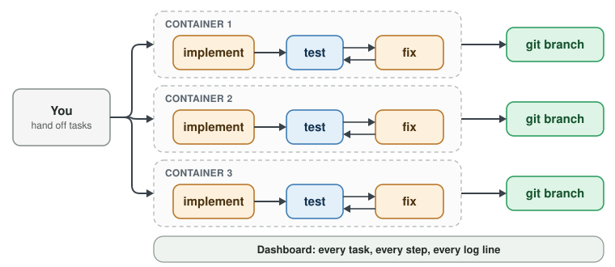

# What Cloche is 

If you're here, you probably already run coding agents. Probably several simultaneously, juggling terminal sessions to keep track.

cloche manages your sessions and makes sure your agents are staying on track.

| Workflows | Containers | Parallelism |
|---|---|---|
| You define the process. Agents can't e.g. forget the test step. | Each run gets its own copy of the project. Rogue Agents can't destroy your machine. | Give Cloche a list of tasks. It runs as many as it can at once. Burn down tickets as fast as your token budget allows |

## Deterministic Workflows

Traditional software is fast but fragile - once you get outside its explicitly covered cases, everything breaks. LLMs are flexible, but
flaky and slow - you're never quite sure if it's going to do what you wanted it to.

Cloche glues together LLM prompts and standard software using a clean and flexible workflow DSL. Use prompts for the parts of your process
where ambiguity is highest to leverage LLMs' superior flexibile reasoning. Use code to zip through the parts of your process that is stable,
or to enforce certain steps are always performed. 

Put your process into a directed Workflow and never worry whether context rot has caused your agents to skip tests again.

---
**Next: [Steps](2-steps.md) →**
