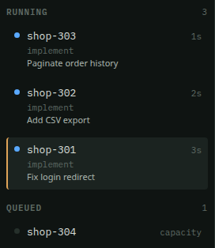
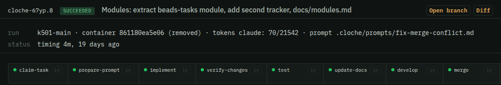

# What Cloche gives you

You already run coding agents. Probably several, in several terminals, checking on each by hand.

Cloche takes over that job. Hand off the work. See what every agent is doing. Get back a branch.

| Workflows | Containers | Parallelism |
|---|---|---|
| You set the path. The agent reports a result. The wiring picks the next step. An agent can't skip the test step. | Each run gets its own copy of your project. Work comes back as a git branch. Agents don't collide. | Give Cloche a list of tasks. It runs several at once. Set the limit with `--max`. |

## See what they're doing

The dashboard lists every task. Three run here. The fourth waits for a free slot.

Open a task to see each step, with its input and its logs.

---
**Next: [Steps](2-steps.md) →**
