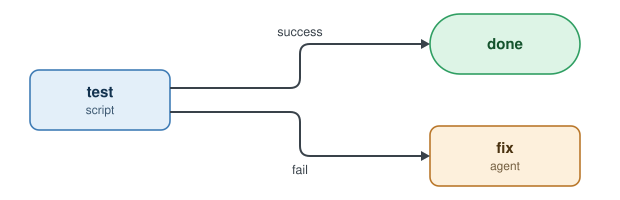

# Steps: the basic building block

A step does one job and reports one result. The result decides what happens next.



The same thing as code:

```
step test {
  run     = "make test"
  results = [success, fail]
}

test:success -> done
test:fail    -> fix
```

`make test` exits 0, so the step reports `success` and the run is done. Any other exit reports `fail`, and `fix` runs next.

## Four kinds of step

| Kind | Key | Does | Use it for |
|---|---|---|---|
| Script | `run` | Runs a shell command | Anything with one right answer: tests, lint, merge |
| Agent | `prompt` | Runs a coding agent | Anything that needs judgment: code, fixes, review |
| Workflow | `workflow_name` | Runs another workflow, waits for its result | Handing work to a container, reusing a process |
| Poll | `poll` | Runs a check on a timer until it gets an answer | Waiting on reviews, CI, approvals |

Results are just names. Declare your own, like `needs-research` or `approved`.

---
**Next: [Workflows](3-workflows.md) →**
