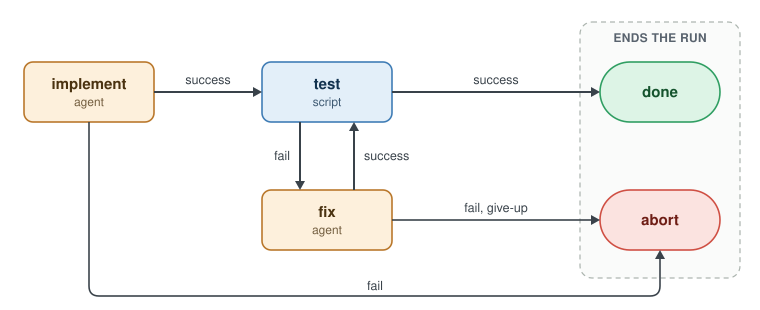
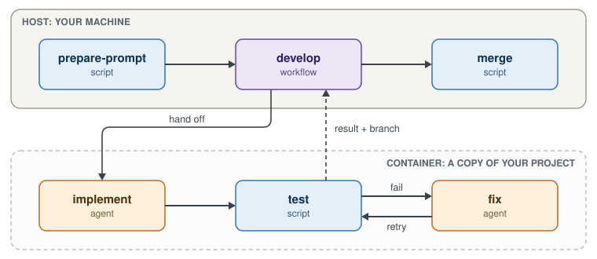

# Workflows: the core of Cloche

A workflow is steps plus wiring. The step reports a result. The wiring picks the next step.

Agents can write anything. They can't change the path. `done` and `abort` end the run.

## Where a workflow runs

| | Container | Host |
|---|---|---|
| Declared by | Default | A `host {}` block |
| Runs in | Docker, on a copy of your project | Your machine, with your permissions |
| Use for | Agent work | Orchestration: prepare, merge, close |

**Agents go in containers.** A host workflow can run an agent, with your full permissions. Save that for work that needs the host, like fixing a merge conflict.

---
**Next: [The DSL](4-the-dsl.md) →**
