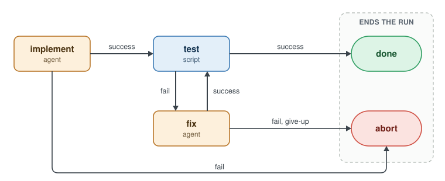

# The DSL

A workflow file names its steps, then wires their results. Here is a basic one to get you started.




## The Containerized Dev Workflow

Here's our basic dev workflow - an LLM prompt to write some code, a script to test, and - if the tests fail - a loop that runs a 'fix' prompt 
to repair the test failure and tries the tests again.

```
workflow develop {
  container {
    image = "my-project:latest"
  }

  step implement {
    prompt  = file(".cloche/prompts/implement.md")
    results = [success, fail]
  }

  step test {
    run     = "make test"
    results = [success, fail]
  }

  step fix {
    prompt       = file(".cloche/prompts/fix.md")
    max_attempts = 2
    results      = [success, fail, give-up]
  }

  implement:success -> test
  implement:fail    -> abort

  test:success      -> done
  test:fail         -> fix

  fix:success       -> test
  fix:fail          -> abort
  fix:give-up       -> abort
}
```

Every line of wiring is an arrow in the diagram. `max_attempts` caps the loop: on the third try, which then reports `give-up`.

## Add a `main` Workflow

`main` is a special Workflow that cloche runs automatically for each task it's given. Aside from how cloche invokes it, `main` is just 
a host-side Workflow like any other. More on how cloche works with `main` in the next section. 

This one here simply hands off control immediately to our containerized "develop" workflow.

```
workflow main {
  host {}

  step develop {
    workflow_name = "develop"
    results       = [success, fail]
  }

  develop:success -> done
  develop:fail    -> abort
}
```

## Check it

`cloche validate` checks the files. `cloche workflow` draws the graph.

```
$ cloche validate
All configuration valid.
$ cloche workflow develop
workflow develop (container)

  ┌───────────┐
  │ implement │ agent  ◀ entry
  └───────────┘
    ├── success ──▶ test
    └── fail, timeout, token-limit ──▶ ABORT

  ┌───────────┐
  │ test      │ script
  └───────────┘
    ├── success ──▶ DONE
    ├── fail ──▶ fix
    └── timeout, token-limit ──▶ ABORT

  ┌───────────┐
  │ fix       │ agent
  └───────────┘
    ├── success ──▶ test
    └── fail, give-up, timeout, token-limit ──▶ ABORT
```

---
**Next: [Tasks](5-tasks.md) →**
