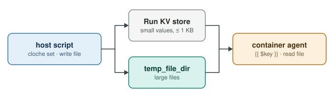

# Passing data between Steps

Steps run one after another, but they don't share memory. Each one is a fresh shell command or a fresh agent session. Cloche gives a run two places to leave things for later Steps:

- **The KV store** for small values: an ID, a branch name, a one-line summary.
- **The run's temp directory** for anything bigger: a task description, a diff, a review.



Both work on the host and in the container. Both last for the whole run.

## The KV store: small values

Every run has a key-value store. On the host, use `cloche`. In a container, use `clo`, which is built into the container image.

| | Host | Container |
|---|---|---|
| Write | `cloche set <key> <value>` | `clo set <key> <value>` |
| Read | `cloche get <key>` | `clo get <key>` |

Values are capped at **1 KB**. Use it for short strings.

A script records what it found:

```
#!/bin/sh
# .cloche/scripts/test.sh
log="$(clo get temp_file_dir)/test.log"
if make test > "$log" 2>&1; then
  exit 0
fi
clo set failed_tests "$(grep -c FAIL "$log")"
exit 1
```

A prompt reads it back with `{{ $key }}`:

```
<!-- .cloche/prompts/fix.md -->
The test suite reported {{ $failed_tests }} failing tests. Fix them without editing the tests.
```

Cloche fills in `{{ $failed_tests }}` before the agent sees the prompt. If the key doesn't exist, the step fails before the agent runs, so a typo can't slip through.

Agents can call `clo get` and `clo set` too. Tell them to in the prompt.

## The temp directory: large files

Anything over 1 KB goes in a file. Cloche creates a scratch directory for every run and puts its path in the KV store as `temp_file_dir`.

The path is relative to the project root, and the directory is shared between the host and the container. A file the host writes there before handing off to a container is visible inside it, and a file a container Step writes there is visible to host Steps after the container finishes. It's gitignored, so nothing in it ends up on your result branch.

The pattern: write the file, then put its **path** in the KV store.

Here a host Step in `main` writes the task description before handing off to `develop`:

```
#!/bin/sh
# .cloche/scripts/prepare-prompt.sh  (host)
path="$(cloche get temp_file_dir)/task_prompt.md"
my-tracker show "$CLOCHE_TASK_ID" > "$path"
cloche set task_prompt_path "$path"
```

And the container's `implement` prompt tells the agent where to find it:

```
<!-- .cloche/prompts/implement.md  (container) -->
Your task is described in /workspace/{{ $task_prompt_path }}. Read it, then implement it.
```

It works the other way too. An agent in the container can write a PR description for a host Step to publish:

```
<!-- in a container prompt -->
When you're done, write a PR description to /workspace/{{ $temp_file_dir }}/pr-description.md.
```

```
#!/bin/sh
# .cloche/scripts/open-pr.sh  (host, after develop)
gh pr create --body-file "$(cloche get temp_file_dir)/pr-description.md" ...
```

## Which one?

| Use | For | Example |
|---|---|---|
| KV | Short strings under 1 KB | `pr_number`, `failed_tests`, `base_branch` |
| Temp directory + KV path | Anything longer, or anything that's naturally a file | task description, test log, review feedback |

When in doubt, use a file. Paths fit easily in the KV store.

## Built-in keys

Cloche sets some keys for you. A few useful ones:

| Key | Value |
|---|---|
| `task_id` | The task this run is working on |
| `temp_file_dir` | This run's scratch directory |
| `prev_step` | The Step that just ran |
| `<workflow>:<step>:result` | The Result a finished Step reported, e.g. `develop:test:result` |
| `child_branch` | After a container Workflow Step finishes: the branch holding its changes |

See [Communicating between Steps](http://cloche.perfectlunacy.com/learn/communicating-between-steps/) for the full list of keys, reading values from stdin or files, and more.

---
**Next: [Tasks](6-tasks.md) →**
