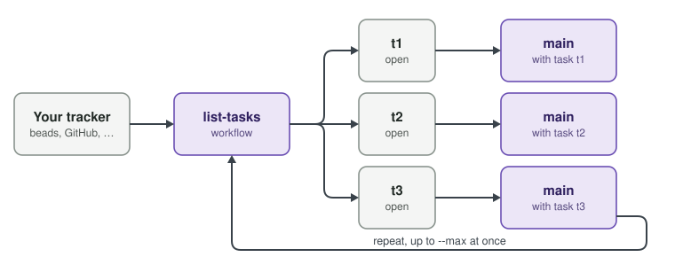

# Tasks

Your Workflows define how to get work done - two _specific_ Workflows turn Cloche into an engine. 
- `list-tasks` finds Tasks.
- `main` runs them.



## `list-tasks`: find the work

`list-tasks` is a host-side workflow that is expected to generate a JSONL list of Tasks for cloche to pick up.

You can use anything you like as the backing source - JIRA, Linear, a SQLite DB, whatever. It just needs to generate the JSONL and write it
to stdout.

```
workflow list-tasks {
  host {}

  step list {
    run     = ".cloche/scripts/list.sh"
    results = [success, fail]
  }

  list:success -> done
  list:fail    -> abort
}
```

See: [List Tasks JSONL](http://cloche.perfectlunacy.com/concepts/#phases) for the full format.
```
{"id":"t1","status":"open","title":"Fix login"}
{"id":"t2","status":"open","title":"Write docs"}
```

## `main`: do the work

You wrote this on the [last page](4-the-dsl.md). Cloche triggers it once per task and sets `CLOCHE_TASK_ID`. 
Make sure you claim tasks within your `main` loop, so that list-tasks doesn't keep feeding them into the engine!

## Start the loop

Cloche runs `list-tasks` -> `main` in a loop, picking up work and executing it until the project's configured concurrency limit is reached.
(See: [Configuration](http://cloche.perfectlunacy.com/learn/configuration/)) 

You can run the loop once to pick up just the next available task with `cloche loop once`:

```
$ cloche loop once
Orchestration loop started (once mode).
Launched run pb3n-main (task t1). Loop stopped.
$ cloche tasks
ID                    STATUS        ASSIGNED    RUN                             TITLE
t1                    open          yes         pb3n-main                       Fix login
t2                    open          -                                           Write docs
```

Or just start it and let it run:

```
$ cloche loop
Orchestration loop started.
```

You can stop the loop with `cloche loop stop` if you need to pause it picking up new work. That _won't_ stop active tasks though, just the
loop itself. If you need to stop a running task, use `cloche stop <task id>` - or see the [CLI reference](http://cloche.perfectlunacy.com/learn/cli-reference/index.html) for more.

That's all of the basics! Steps, Workflows and the task loop. You can now build a working Cloche project by hand.

---
**Next: [Let agents build them](6-let-agents-build-them.md) →**
