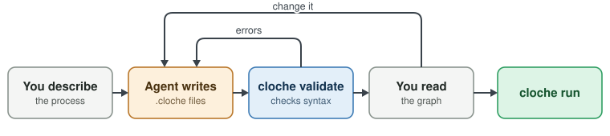

# Let agents build them

You don't have to write the DSL. Describe the process. Your agent writes it. You check the graph.

## Tips

| Do this | Tell your agent |
|---|---|
| Teach it Cloche first | "Run `cloche --help` and build yourself a skill for working with Cloche projects." |
| Point it at the docs | "Read [the Cloche docs](http://cloche.perfectlunacy.com/learn/index.html) before you write a workflow." |
| Make it check its work | "Run `cloche validate` before you finish." |
| Describe the path, not the syntax | "Implement in a container. Run make test. Try to fix failures, twice at most. Then stop." |
| Debug through it | "Read `cloche logs` for this task. Why did test fail?" |
| Improve prompts from failures | "The fix step keeps editing tests. Tighten its prompt." |

## Read the graph, not the syntax

`cloche workflow <name>` draws what the agent wrote. If the arrows are right, the workflow is right.

---
**Next: [Patterns](7-patterns.md) →**
