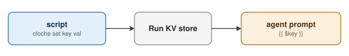
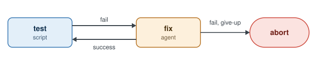
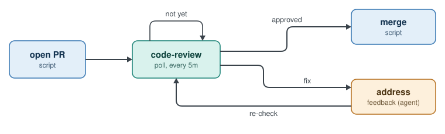
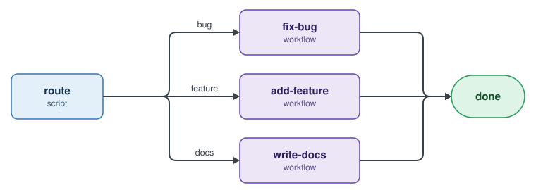
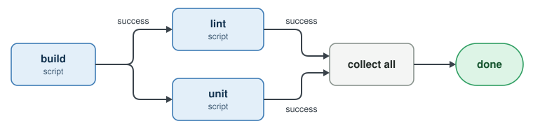

# Patterns

Five shapes cover most workflows.

## Pass data between steps



```
# script on the host; use clo set inside a container
cloche set test_summary "3 failed"

# in a prompt
Tests reported: {{ $test_summary }}
```

Values cap at 1 KB. For anything bigger, write a file and pass its path.

## Fix and retry



```
step fix {
  prompt       = file(".cloche/prompts/fix.md")
  max_attempts = 2
  results      = [success, fail, give-up]
}
```

Out of attempts means `give-up`. Set a limit so the loop ends.

## Poll for feedback



```
step code-review {
  poll     = "scripts/check-pr-review.sh"
  interval = "5m"
  timeout  = "48h"
  results  = [approved, fix]
}
```

Exit 0 with no result means "not yet." Print a result to move on.

## Router



A script picks the sub-workflow. Each target is a `workflow_name` step.

```
step route {
  run     = ".cloche/scripts/route.sh"
  results = [bug, feature, docs, fail]
}

route:bug     -> fix-bug
route:feature -> add-feature
route:docs    -> write-docs
route:fail    -> abort
```

The script decides however suits your project. A label on the task works well:

```
#!/bin/sh
echo "CLOCHE_RESULT:$(my-tracker label "$CLOCHE_TASK_ID")"
```

## Parallel paths



```
build:success -> lint
build:success -> unit
collect all(lint:success, unit:success) -> done
```

Wire one result to two steps to split. `collect all` waits for both. `collect any` waits for the first.

---
**Next:** [install Cloche](http://cloche.perfectlunacy.com/getting-started/installation/), or read the [full docs](http://cloche.perfectlunacy.com/learn/index.html).
